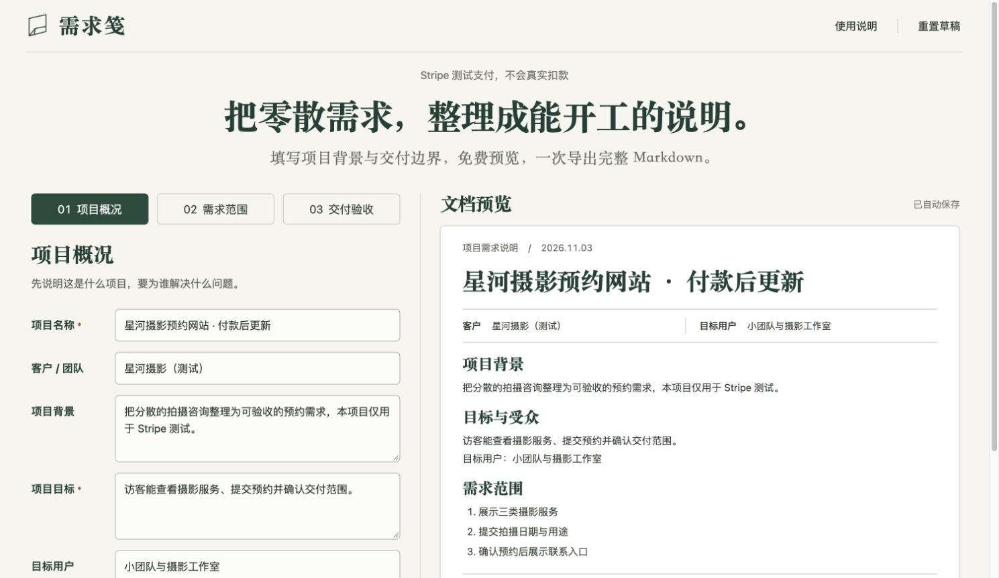

<p align="center"></p>

<h1 align="center">OPC Harness</h1>

<p align="center">描述网站，沿用偏好，带着验证结果交付。</p>

<p align="center">
  <a href="README.md">English</a> · 简体中文<br>
  <a href="#快速开始">快速开始</a> · <a href="#工作方式">工作方式</a> · <a href="docs/website-example.md">实际案例</a> · <a href="docs/configuration.md">配置文档</a> · <a href="CONTRIBUTING.md">参与贡献</a> · <a href="LICENSE">MIT 开源协议</a>
</p>

<p align="center">
  <a href="https://github.com/AniChikage/opc-harness/actions/workflows/ci.yml"></a>
  <a href="LICENSE"></a>
  
</p>

OPC Harness 把 **Codex 和 Claude Code** 接到一套可以重复执行的建站流程：沿用设计偏好、接入支付、部署 Cloudflare，并留下实际验证结果。

配置一次，之后在新项目里直接描述要做什么网站。Agent 读取个人默认配置，初始化项目，完成产品适配，再继续实现、测试和部署。

**当前状态：早期 MVP，v0.2.0。** 内置 HTML/CSS/JavaScript、Cloudflare Workers + D1，以及演示支付或 Stripe **测试**支付。它通过宿主指令和 Skill 工作，不是强制运行时 Hook，也不替代现有 coding agent；账号和凭据由你自己管理。



*实际产物：[需求笺](https://xuqiu-jian-20261103-c84f.comicyueyu.workers.dev)，免费预览中文需求，通过 Stripe 测试结账后导出 Markdown。截图来自真实应用，使用虚构示例数据。*

## 能做什么

- **一次配置，两套宿主**：安装 Codex 和 Claude Code 的用户级入口 Skill 与指令。下次描述网站时，无需再手动初始化每个项目。
- **沿用个人偏好**：把设计、支付模式、部署平台放在个人 profile 中；已经创建的项目保留自身配置。
- **从能运行的模板开始**：内置实时预览、结账、服务端权益确认和 Markdown 下载。Agent 继续把模板改成实际产品。
- **支付与交付由服务端核验**：支持演示支付与 Stripe 托管测试 Checkout，验证 Webhook 签名、订单、金额和币种，通过数据库事务处理重复事件。
- **完成 Cloudflare 交付**：打包、创建 D1、迁移、发布 Worker，再按项目身份和代码指纹验收远端版本，保存资源归属供后续发布使用。
- **区分不同验证范围**：分别记录 HTTP、支付、打包与部署结果；源代码变化后，旧证据标为过期。界面与真实 Stripe 交易还需单独验收。
- **下一次会话可以接着做**：项目内保留配置、指令、运行时和证据，恢复时先检查当前状态。

## 快速开始

准备 **Node.js 22.13+**、npm，以及已经安装和登录的 Codex 或 Claude Code。部署需要你自己的 Cloudflare 账号，Stripe 测试支付需要自己的测试环境。Harness 本身不需要模型 API 密钥。

### 1. 安装一次

```sh
git clone https://github.com/AniChikage/opc-harness.git
cd opc-harness
npm ci
node bin/opc.mjs setup --global --host both
```

安装会复制独立运行时，在两套宿主的用户指令中追加带标记的入口，保留已有指令，并备份被修改的文件。它不会修改模型配置或 API 凭据。需要先看目标路径时，可增加 `--dry-run --json`。

CLI **尚未发布到 npm**，请从本源码仓库使用，或自行执行 `npm pack`。不要依赖 npm 上可能存在的同名包。

### 2. 直接描述网站

在准备放项目的目录中，新开一个 **Codex / Claude Code 会话**，直接说：

```text
做一个面向自由职业者的中文项目需求整理网站。
免费预览，付费导出 Markdown。
按我的默认配置完成设计、支付测试和 Cloudflare 预览部署。
```

入口 Skill 会引导 Agent 选定项目目录、自动初始化、读取计划，再继续执行。遇到账号未登录或缺少密钥时，应说明具体缺项，并继续不受影响的工作。

自动选择取决于宿主是否加载了用户指令与 Skill。旧会话没有刷新时，请新建会话，或明确说“使用 opc-harness”。宿主权限策略和项目原有指令仍然生效。

### 3. 在项目里继续

```sh
cd /path/to/your-site
node .opc/runtime/bin/opc.mjs inspect --json
node .opc/runtime/bin/opc.mjs plan --json
node .opc/runtime/bin/opc.mjs dev --port 8787
```

打开 `http://127.0.0.1:8787`。空项目的 `dev` 会生成模板并应用本地 D1 迁移。已有应用先检查再生成；文件冲突会被报告，不会直接覆盖修改。

不想安装全局入口，也可以选择[仅安装到项目](docs/configuration.md#project-only-installation)。

## 工作方式

```text
你的需求 + 个人 profile
          ↓
Codex / Claude Code 加载入口 Skill
          ↓
项目配置 + 共享建站 Skill
          ↓
设计 → 实现 → 支付测试 → 部署 → 验收
          ↓
保存带源代码指纹的项目证据
```

Coding agent 负责理解产品和设计，Skill 定义执行流程，CLI 处理初始化、配置检查、资源校验和部署等重复操作。浏览器验收和真实 Stripe 测试由 Agent 调用可用工具完成，不把 CLI 尚未自动化的环节说成已经通过。

| 能力 | v0.2.0 支持范围 |
| --- | --- |
| 宿主 | Codex / Claude Code 用户指令与 Skill |
| 前端 | 原生 HTML、CSS、JavaScript；一个 `editorial` 预设 |
| 后端 | Cloudflare Worker + D1 |
| 支付 | 演示支付、Stripe TEST 一次性付款 |
| 托管 | Cloudflare 预览发布 |
| 验证 | HTTP、演示支付、打包、部署；Agent 另行记录浏览器和真实 Stripe 验收 |

已有框架和项目要求优先，内置 recipe 尚未适配所有框架。

## 支付与部署

起始模板的示例商品是 **$19 USD**。Agent 可以根据产品修改服务端商品和匹配的 Stripe 测试 Price；需求笺案例实际使用 **¥29 CNY**。

| 支付模式 | 含义与验收方式 |
| --- | --- |
| `demo` | 模拟结账 → 服务端确认 → 权益 → 下载；不是 Stripe 交易。 |
| `stripe_test` | 真实 Stripe 测试 Checkout → 本站签名 Webhook → 确认导出权益。 |

`payments test` 只自动运行演示流程。Stripe 模式会明确提示完成真实测试交易，由 Agent 继续使用外部工具验收；它不会伪造成功。只有成功页面跳转不能解锁下载。

在生成的项目里发布：

```sh
node .opc/runtime/bin/opc.mjs deploy --dry-run --json
node .opc/runtime/bin/opc.mjs deploy --json
node .opc/runtime/bin/opc.mjs verify --url https://your-worker.workers.dev --json
```

预览发布也会在你的 Cloudflare 账号内创建真实资源。请在本机保留 `.opc/resources.json` 的资源归属记录；不会接管未知的同名资源。本地与远程 D1 各自独立。[支付配置与发布说明](docs/configuration.md#stripe-test-payments)。

## 实际跑过的案例

[需求笺案例记录](docs/website-example.md) 展示了从一句中文需求到可访问网站的过程：

**免费预览 → Stripe Sandbox 结账 → 签名回调 → D1 订单变为 paid → 下载当前需求的 Markdown。**

实际完成了 ¥29 CNY 测试交易，并核对浏览器下载文件中的全部 13 个自定义字段；付款后修改草稿再导出也通过。这个网站包含产品自己的表单、校验和文档生成逻辑，不是原样交付起始模板。网站源码与本 harness 仓库分开维护。

Harness 自动化测试、案例自己的测试和外部服务验收分别记录，详见[验证范围](docs/verification.md)。

## 开发

```sh
npm ci
npm test
npm run check
npm pack --dry-run
```

CLI 使用原生 ESM JavaScript。测试使用 Node test runner，支付 SQL 与事务在真实 SQLite 上运行；自动化测试不需要 Stripe 密钥或 Cloudflare 账号。依赖通过公共 npm registry 锁定。

| 目录 | 职责 |
| --- | --- |
| `src/global.mjs` | 用户级安装、profile、备份与回滚 |
| `src/workflows.mjs` | 项目初始化、验证、支付检查与部署 |
| `src/core.mjs` | 配置校验、受管文件、代码指纹和证据 |
| `skills/opc-build-website/` | 共享流程与设计、支付、部署参考 |
| `templates/paid-site/` | 可运行的起始网站 |
| `test/` | CLI、安装、支付与部署回归测试 |

## 当前边界

- 暂不支持真实扣款、结算、订阅、自动商户开户或 Vercel 发布。
- 自动触发依靠宿主指令和 Skill，仍受宿主加载方式、权限策略和当前请求约束；每台机器需要独立安装。
- `editorial` 是设计起点，参考图还原和最终视觉质量需要 Agent 实现并通过浏览器检查。
- 密钥只放环境变量、Git 忽略的 `.dev.vars` 或 Worker Secrets，不放在 profile、Skill 或公开证据里。
- 已验证 macOS 安装和两套宿主入口；原生 Windows 安装尚未验证。CI 单独覆盖 Node 测试。

欢迎可复现的问题、聚焦的修复和文档改进。请阅读[贡献指南](CONTRIBUTING.md)，或提交 [Issue](https://github.com/AniChikage/opc-harness/issues)。

## 开源协议

[MIT](LICENSE)。依赖保留各自协议。Codex、Claude Code、Stripe、Cloudflare 均为第三方产品，OPC Harness 是独立项目。
