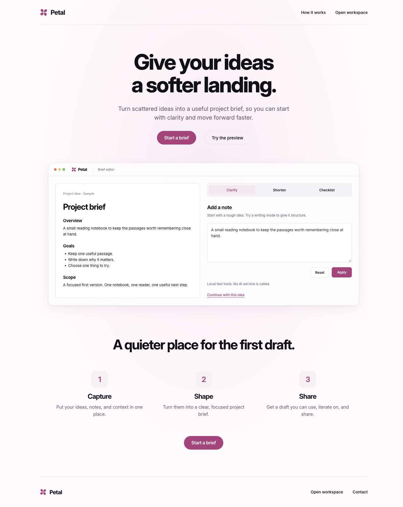
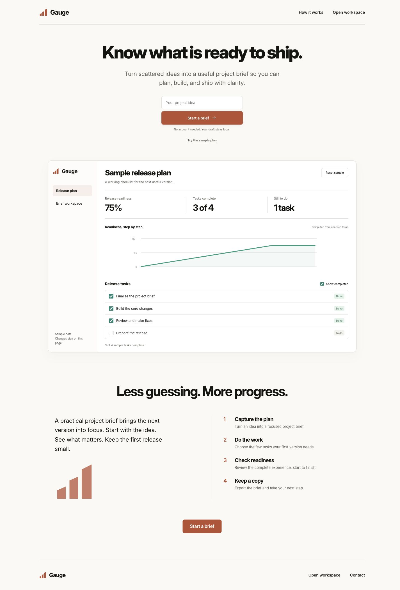
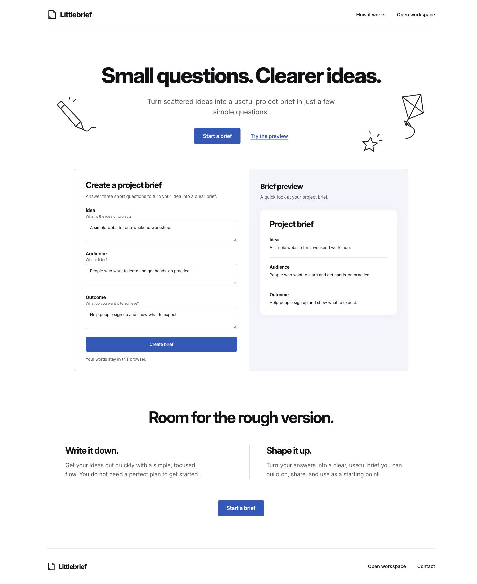
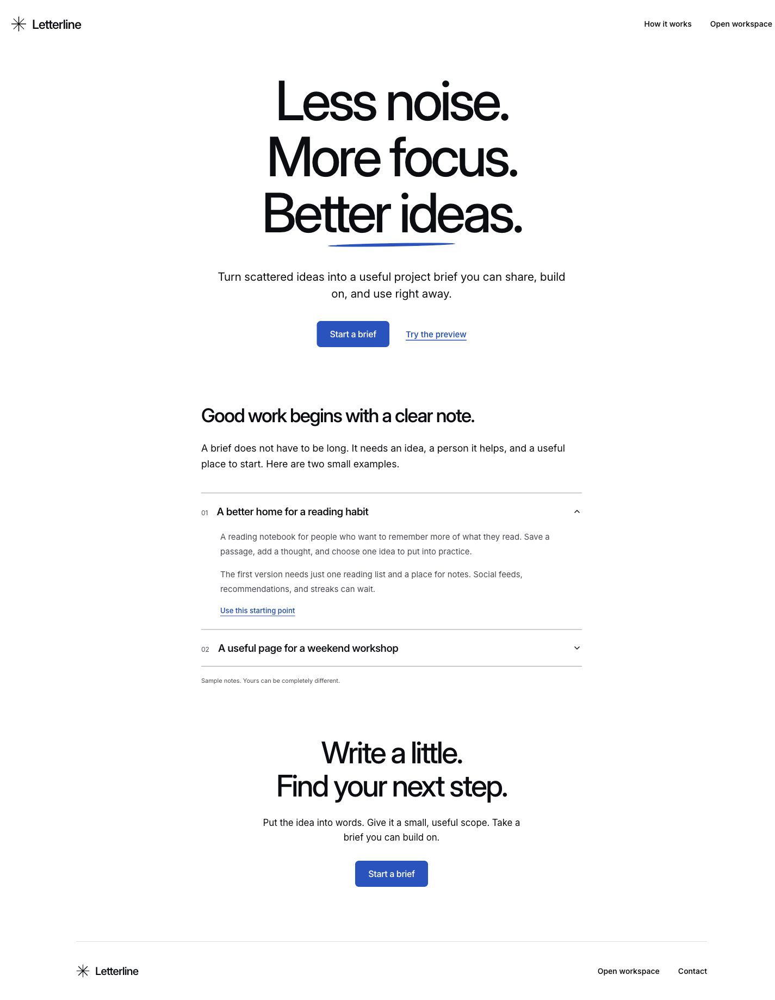
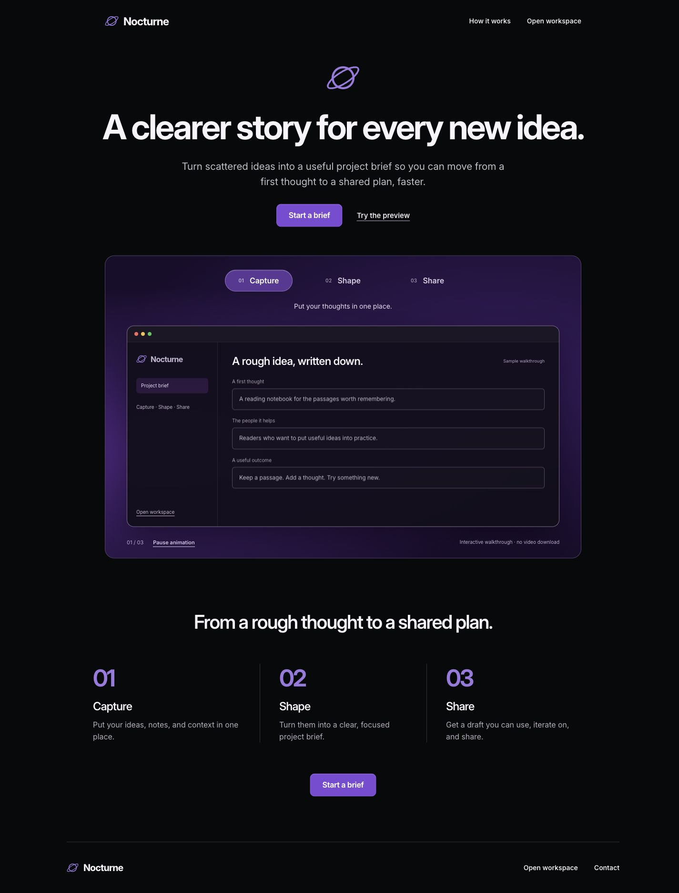

# Complete templates

[README](../README.md) · [Configuration](configuration.md) · [Module guide](modules.md)

Choose a complete layout instead of asking the agent to design one from scratch. Gallery previews and generated projects use the same renderer and bundled assets. A selected template keeps its typography, layout, responsive rules, and interactions; branding and content are data.

## Catalog

| ID | Template | Included interaction | Default payments |
| --- | --- | --- | --- |
| `petal` | Soft pink tool landing | Editable preview, Clarify / Shorten / Checklist, draft handoff | None |
| `gauge` | Warm data-led landing | Quick-start form, local checklist, computed chart, completion filter | None |
| `scribble` | Friendly hand-drawn form | Live three-question preview, safe draft handoff | None |
| `letterline` | Sparse editorial landing | Expandable sample notes, sample brief handoff | None |
| `nocturne` | Premium dark product landing | Automatic walkthrough, step controls, motion preference support | None |
| `paperplane` | Project brief tool | Editor, autosave, free preview, Markdown export | Demo |
| `saas` | Software homepage | Product walkthrough, FAQ, brief workspace | None |
| `portfolio` | Studio portfolio | Work filters, project details, email contact | None |
| `docs` | Documentation | Full-text guide search, article navigation, outline copying | None |
| `directory` | Resource directory | Search, category filters, details, saved favorites | None |
| `dashboard` | Task workspace | Add/delete tasks, status changes, filters, CSV export | None |
| `store` | Digital brief kit | Product page, FAQ, complete editor and export checkout | Demo |
| `event` | Event homepage | Agenda filters, session details, calendar download | None |
| `pulse` | Bold landing | Product preview, workflow tabs, brief workspace | None |
| `studio` | Service landing | Service inquiries, project details, email contact | None |
| `console` | Personal contact admin | Contact CRUD, stages, search, CSV export | None |

Contacts, favorites, drafts, and task data live in the visitor's browser. The dashboard does not claim to provide a shared team database. The event calendar saves an agenda; it does not register attendees. The storefront sells the included customizable brief kit, not an arbitrary file. Add additional business behavior when your product requires it.

## Five original landing styles

These v0.6.0 templates turn five selected visual directions into complete, usable templates. Layout, type rhythm, palette and product framing follow the references; names, copy, marks, vector illustrations and product interfaces are original. Reference websites appear only in the catalogue. Their source, logos, screenshots and videos are not bundled into generated sites.

| Selected reference | Template | Visual direction |
| --- | --- | --- |
| #03 · [Snapok](https://snapok.app/) | `petal` / Petal | Soft pink, centered utility story, native-style editor |
| #06 · [DataFast](https://datafa.st/) | `gauge` / Gauge | Warm white, heavy type, calm dashboard |
| #16 · [Tally](https://tally.so/) | `scribble` / Littlebrief | White space, original line drawings, friendly form |
| #18 · [Buttondown](https://buttondown.com/) | `letterline` / Letterline | Oversized editorial typography, blue accents, narrow reading column |
| #19 · [Screen Studio](https://screen.studio/) | `nocturne` / Nocturne | Black and violet, premium product walkthrough |

| Petal | Gauge | Littlebrief | Letterline | Nocturne |
| --- | --- | --- | --- | --- |
| <a href="images/petal.png"></a> | <a href="images/gauge.png"></a> | <a href="images/scribble.png"></a> | <a href="images/letterline.png"></a> | <a href="images/nocturne.png"></a> |

These screenshots show the rendered pages. Use the local studio for interactive desktop and mobile previews.

Use v0.6.0 or later for these templates. From a source checkout:

```sh
npm run build
node bin/opc.mjs gallery --port 8789
node bin/opc.mjs create --dir ../my-product --name my-product \
  --template scribble --stack cloudflare --payment none \
  --brand 'Small Hours' --headline 'Make room for your next good idea.' --host both
```

Open the returned studio URL with `?type=landing` or `?template=scribble`. Select a template, edit brand settings and copy the command. The local studio uses its own runtime, so template selection and project generation stay on the same version. Static catalogue exports use `opc-harness`; install a matching runtime before running their commands.

Petal's modes are local text operations, not an AI service. Gauge's percentages are computed from its four sample tasks, not business analytics. Littlebrief's form and Letterline's sample notes transfer a one-use draft to the workspace in session storage; existing saved work is preserved until you explicitly save the new brief. Nocturne is a real animated HTML walkthrough, not a video recorder or native application. The animation starts automatically, pauses offscreen or when focused, supports manual steps, and respects reduced motion.

All five include the existing working brief workspace. Free mode exports Markdown locally; paid Cloudflare modes continue to use server-verified export access. There is no alternate landing-page download that bypasses checkout. The Inter font is bundled locally with its [SIL Open Font License](https://github.com/rsms/inter/blob/master/LICENSE.txt); pages make no external font requests.

To make these templates available to your local Codex and Claude Code setup, refresh the installed runtime without changing the saved profile:

```sh
node bin/opc.mjs setup --global --host both
```

Then start a new agent chat and say: `Build a website for a reading notebook. Use the petal template, preserve its design, and replace all sample content with my product content.`

## Choose visually

```sh
npx --yes opc-harness@0.6.1 gallery
```

From this source checkout, run `npm ci`, `npm run build` and `node bin/opc.mjs gallery` to open the offline catalogue. The product homepage and its own development server live in [opc-harness-web](https://github.com/AniChikage/opc-harness-web). Filter by category, open the actual template, or choose one and enter your brand and project folder to copy a generation command. Catalogue checkout is disabled; payment acceptance runs in the generated project.


## Choose and generate in the terminal

```sh
npx --yes opc-harness@0.6.1 create --interactive
```

The wizard asks for a frontend category, template, brand, headline, stack, compatible payment mode, and contact email when relevant. Without `--dir`, creation uses a new `my-website` subdirectory. Use an explicit directory for other names:

```sh
npx --yes opc-harness@0.6.1 create \
  --dir ./studio --name studio --template portfolio \
  --brand 'North Star Studio' --email hello@example.com --host both
cd studio
node .opc/runtime/bin/opc.mjs dev
```

A noninteractive runner should pass flags instead of `--interactive`. Codex and Claude Code can list `templates --json`, present matching choices in conversation, then run `create` themselves.

## Configure without editing HTML or CSS

Store site content in an English JSON file:

```json
{
  "brand": "North Star Studio",
  "headline": "Useful design for thoughtful people.",
  "description": "An independent practice for small teams building useful products.",
  "accent": "#89432e",
  "contactEmail": "hello@example.com",
  "items": [
    {
      "name": "A quieter workspace",
      "category": "Product",
      "description": "A focused planning tool for independent makers."
    }
  ]
}
```

```sh
node .opc/runtime/bin/opc.mjs configure --site-config ./site.json
```

`items` supplies portfolio projects, documentation articles, directory resources, event sessions, or initial dashboard tasks. Each item requires `name`, `category`, and `description`. Directory items may add an absolute HTTPS `url`. Dashboard categories map to `Planned`, `In progress`, or `Done`; other values start as planned tasks. Existing browser task data is preserved.

For events, add an `event` object with ISO timestamps and a location:

```json
{
  "event": {
    "startsAt": "2027-06-01T12:00:00Z",
    "endsAt": "2027-06-01T15:00:00Z",
    "location": "Online"
  }
}
```

The date, time, location, and calendar download use these values. Times on the page are shown in UTC. Replace the example agenda before announcing a real event.

## Switch layouts safely

```sh
node .opc/runtime/bin/opc.mjs configure \
  --template directory --payment none --brand 'Useful Things'
```

Configuration and generated files are checked together. A user-edited template file blocks the update before the project or Worker configuration changes. There is no overwrite flag. Keep customized applications and make deliberate changes in their own code instead.

A project with an existing deployment ownership record cannot change payment modes through this shortcut; moving a deployed product between free and paid needs an explicit migration.

## Keep the chosen design

When the user says "use this style", the selected layout, typography, spacing and interactions are the product. Scaffolding records a design lock in `.opc/design-lock.json`: a structural signature for every generated page plus the generated style, behavior and bundled font files. Text, brand values and the accent color are configuration and never count as drift.

Check it at any time:

```sh
node .opc/runtime/bin/opc.mjs design --json
```

`ok: true` means the generated site still matches the selected design. A non-empty `drifted` list names files whose structure, classes, styles or behavior changed. Restore those files, or accept a deliberate redesign explicitly:

```sh
node .opc/runtime/bin/opc.mjs design --accept
```

`verify` and `doctor` report the same `design-preserved` check, so a finished site cannot claim success while the chosen design was silently replaced.

## Reuse defaults

```sh
npx --yes opc-harness@0.6.1 setup --global --host both --template portfolio --payment none
npx --yes opc-harness@0.6.1 preferences --interactive
```

Setup preserves an existing profile. `preferences` explicitly updates it, backs up the previous JSON, and affects future projects. Existing project choices remain independent.

## Payment and hosting choices

- `none`: free exports, no checkout, no payment database. Use local preview, a Cloudflare Worker, or `export --out` for static hosting.
- `demo`: clearly labeled simulated checkout backed by server-side orders and entitlements.
- `stripe_test`: a real Stripe test Checkout and signed webhook, using your matching test Price and server secrets.

Set a different one-time test product without changing application code:

```sh
node .opc/runtime/bin/opc.mjs configure --amount 2900 --currency cny
node .opc/runtime/bin/opc.mjs doctor --json
```

Amounts use the currency's minor unit: CNY 29 is `2900`; JPY 2900 is `2900`. Supported currencies are USD, EUR, GBP, CNY, JPY, CAD, and AUD. The Stripe test Price must match exactly. Do not change an active product with pending orders without planning how to fulfill those orders.

Export a free site:

```sh
node .opc/runtime/bin/opc.mjs export --out ../static-site
```

Host those files at an HTTP(S) origin root. Paid static exports are refused because checkout requires the Worker backend. Cloudflare remains the automated deployment adapter; static output can be uploaded to other static hosts using their normal deployment workflow.
