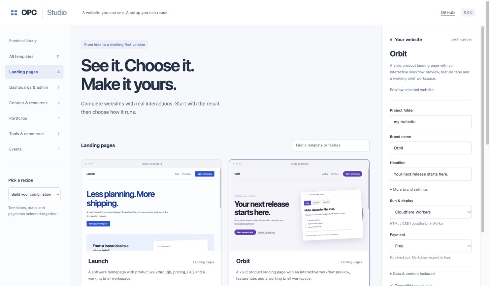
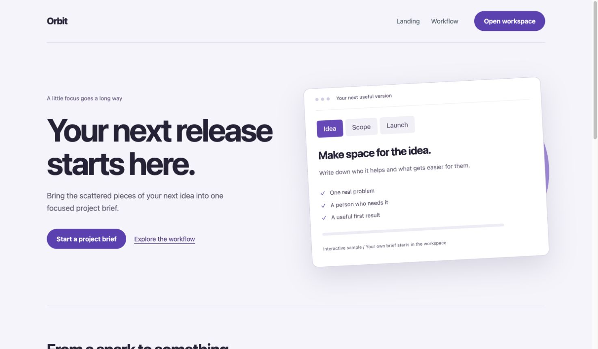
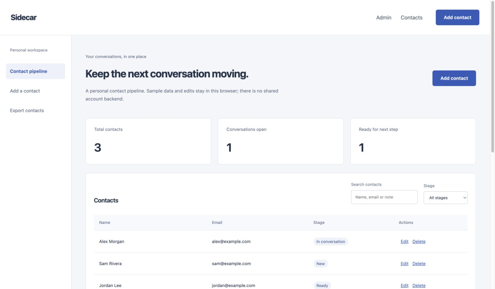

# Complete templates

[README](../README.md) · [Configuration](configuration.md) · [Module guide](modules.md)

Choose a complete layout instead of asking the agent to design one from scratch. Gallery previews and generated projects use the same renderer and bundled assets. A selected template keeps its typography, layout, responsive rules, and interactions; branding and content are data.

## Catalog

| ID | Template | Included interaction | Default payments |
| --- | --- | --- | --- |
| `paperplane` | Project brief tool | Editor, autosave, free preview, Markdown export | Demo |
| `saas` | Software homepage | Product walkthrough, FAQ, brief workspace | None |
| `portfolio` | Studio portfolio | Work filters, project details, email contact | None |
| `docs` | Documentation | Full-text guide search, article navigation, outline copying | None |
| `directory` | Resource directory | Search, category filters, details, saved favorites | None |
| `dashboard` | Task workspace | Add/delete tasks, status changes, filters, CSV export | None |
| `store` | Digital brief kit | Product page, FAQ, complete editor and export checkout | Demo |
| `event` | Event homepage | Agenda filters, session details, calendar download | None |
| `pulse` | Bold landing | Product preview, workflow tabs, brief workspace | None |
| `studio` | Service landing | Service inquiries, project details, email contact | None |
| `console` | Personal contact admin | Contact CRUD, stages, search, CSV export | None |

Contacts, favorites, drafts, and task data live in the visitor's browser. The dashboard does not claim to provide a shared team database. The event calendar saves an agenda; it does not register attendees. The storefront sells the included customizable brief kit, not an arbitrary file. Add additional business behavior when your product requires it.

## Choose visually

```sh
npx --yes opc-harness@0.5.0 gallery
```

For this source branch, run `node bin/opc.mjs gallery` before npm publication. Open the reported local URL. Filter by category, open the actual template, or choose one and enter your brand and project folder to copy a generation command. Gallery checkout is disabled; payment acceptance runs in the generated project.







## Choose and generate in the terminal

```sh
npx --yes opc-harness@0.5.0 create --interactive
```

The wizard asks for a frontend category, template, brand, headline, stack, compatible payment mode, and contact email when relevant. Without `--dir`, creation uses a new `my-website` subdirectory. Use an explicit directory for other names:

```sh
npx --yes opc-harness@0.5.0 create \
  --dir ./studio --name studio --template portfolio \
  --brand 'North Star Studio' --email hello@example.com --host both
cd studio
node .opc/runtime/bin/opc.mjs dev
```

A noninteractive runner should pass flags instead of `--interactive`. Codex and Claude Code can list `templates --json`, present matching choices in conversation, then run `create` themselves.

## Configure without editing HTML or CSS

Store site content in an English JSON file:

```json
{
  "brand": "North Star Studio",
  "headline": "Useful design for thoughtful people.",
  "description": "An independent practice for small teams building useful products.",
  "accent": "#89432e",
  "contactEmail": "hello@example.com",
  "items": [
    {
      "name": "A quieter workspace",
      "category": "Product",
      "description": "A focused planning tool for independent makers."
    }
  ]
}
```

```sh
node .opc/runtime/bin/opc.mjs configure --site-config ./site.json
```

`items` supplies portfolio projects, documentation articles, directory resources, event sessions, or initial dashboard tasks. Each item requires `name`, `category`, and `description`. Directory items may add an absolute HTTPS `url`. Dashboard categories map to `Planned`, `In progress`, or `Done`; other values start as planned tasks. Existing browser task data is preserved.

For events, add an `event` object with ISO timestamps and a location:

```json
{
  "event": {
    "startsAt": "2027-06-01T12:00:00Z",
    "endsAt": "2027-06-01T15:00:00Z",
    "location": "Online"
  }
}
```

The date, time, location, and calendar download use these values. Times on the page are shown in UTC. Replace the example agenda before announcing a real event.

## Switch layouts safely

```sh
node .opc/runtime/bin/opc.mjs configure \
  --template directory --payment none --brand 'Useful Things'
```

Configuration and generated files are checked together. A user-edited template file blocks the update before the project or Worker configuration changes. There is no overwrite flag. Keep customized applications and make deliberate changes in their own code instead.

A project with an existing deployment ownership record cannot change payment modes through this shortcut; moving a deployed product between free and paid needs an explicit migration.

## Reuse defaults

```sh
npx --yes opc-harness@0.5.0 setup --global --host both --template portfolio --payment none
npx --yes opc-harness@0.5.0 preferences --interactive
```

Setup preserves an existing profile. `preferences` explicitly updates it, backs up the previous JSON, and affects future projects. Existing project choices remain independent.

## Payment and hosting choices

- `none`: free exports, no checkout, no payment database. Use local preview, a Cloudflare Worker, or `export --out` for static hosting.
- `demo`: clearly labeled simulated checkout backed by server-side orders and entitlements.
- `stripe_test`: a real Stripe test Checkout and signed webhook, using your matching test Price and server secrets.

Set a different one-time test product without changing application code:

```sh
node .opc/runtime/bin/opc.mjs configure --amount 2900 --currency cny
node .opc/runtime/bin/opc.mjs doctor --json
```

Amounts use the currency's minor unit: CNY 29 is `2900`; JPY 2900 is `2900`. Supported currencies are USD, EUR, GBP, CNY, JPY, CAD, and AUD. The Stripe test Price must match exactly. Do not change an active product with pending orders without planning how to fulfill those orders.

Export a free site:

```sh
node .opc/runtime/bin/opc.mjs export --out ../static-site
```

Host those files at an HTTP(S) origin root. Paid static exports are refused because checkout requires the Worker backend. Cloudflare remains the automated deployment adapter; static output can be uploaded to other static hosts using their normal deployment workflow.
