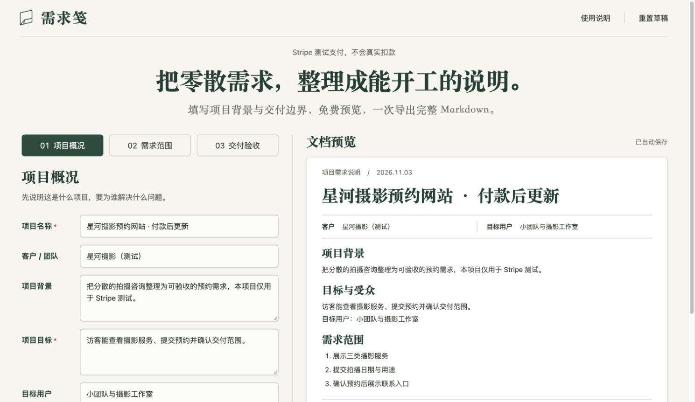
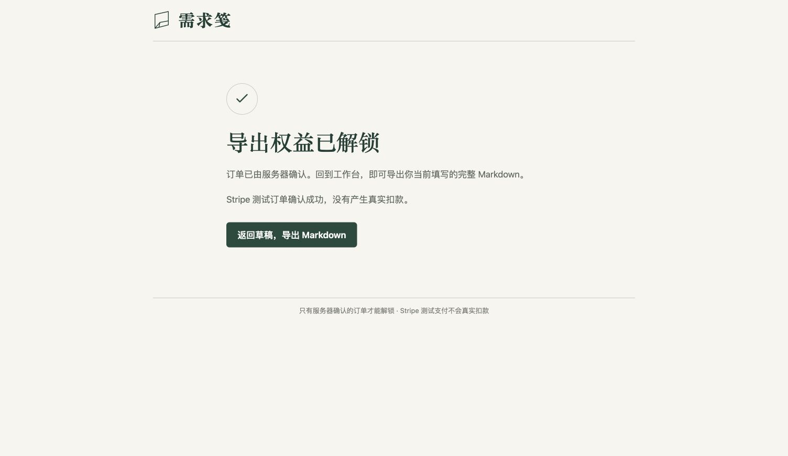

# A real website built with OPC Harness

[English README](../README.md) · [中文说明](../README.zh-CN.md)

**需求笺** turns a project's background, scope, delivery boundaries, and acceptance criteria into a Chinese requirements document.

[Try the deployed tool](https://xuqiu-jian-20261103-c84f.comicyueyu.workers.dev). It uses Stripe **test** payments; no real money is charged.

## The request

```text
做一个中文项目需求整理网站，免费预览、付费导出 Markdown，
完成设计、支付测试和 Cloudflare 部署。
```

The project started from the installed personal harness, with entry instructions for both Codex and Claude Code. The agent implemented a product-specific application, keeping the starter's plain HTML/CSS/JavaScript and Worker/D1 stack.



## What the agent built

- A Chinese three-step editor: project overview, scope, and acceptance.
- Thirteen input fields, free live preview, local autosave, copy, and reset confirmation.
- A one-time ¥29 CNY export product using Stripe-hosted Checkout in a testing environment.
- Server-generated Markdown containing the current custom inputs, including scope exclusions, acceptance, dependencies, budget, and change policy.
- A Cloudflare deployment with durable orders and Webhook processing in D1. Draft text is processed for export without being stored in the database.

The warm paper background, Chinese serif headings, split workspace, and document preview follow the chosen editorial direction. The application screens show fictional project data.

## What actually ran

The initial demo-payment run was followed by a separate real Stripe test acceptance:

1. Fill every input with a custom Chinese brief and confirm the free preview.
2. Click export in the deployed website and enter Stripe Sandbox Checkout at ¥29 CNY.
3. Complete the hosted form using Stripe's official test card and synthetic contact information.
4. Receive Stripe's signed `checkout.session.completed` event at the deployed Webhook.
5. Confirm the corresponding Stripe Session is paid, the D1 order is paid, and the matching entitlement exists.
6. Return to the editor and download the actual Markdown file. All 13 custom fields were checked.
7. Edit the draft and export again with the existing paid entitlement. The new document contains the changed content.



Remote checks also confirmed that demo completion is disabled in Stripe mode, unsigned Webhooks are rejected, and incorrect order/export credentials cannot unlock a document. Desktop and mobile checks ran against the deployed app, including reload and retained entitlement.

## What this example means

The harness supplied installation, host routing, workflow guidance, payment/deployment primitives, and scoped verification. The agent still wrote the product-specific form, validation, Markdown generation, and Stripe setup helper.

Those application-specific modules are maintained outside this repository. The included starter remains a generic $19 USD demo/test product; this walkthrough does not imply that copying it alone creates the finished Chinese application or automatically provisions Stripe resources.

No live charge, settlement, subscription, tax workflow, or proof of customer demand is claimed. See [verification](verification.md) for the test scopes and [configuration](configuration.md) to reproduce the supported workflow with your own accounts.
