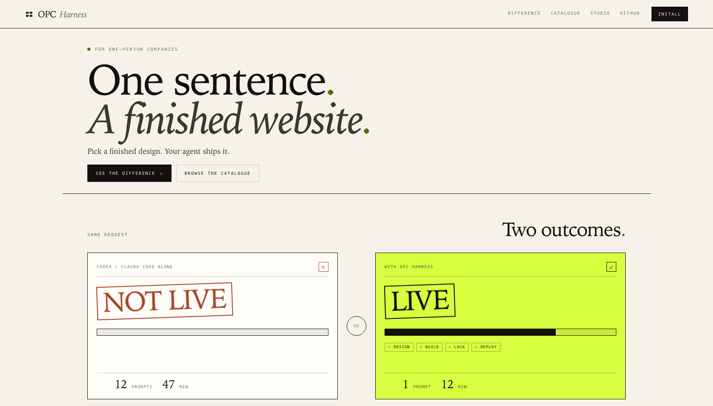

# OPC Harness Web

The independent website workspace for OPC Harness: product homepage, six-second workflow illustration, visual Studio, live branding previews and a deployable static export. This private package is not published to npm.



## Run locally

From the repository root:

```sh
npm ci
npm --prefix web run dev
```

Open the reported URL, normally `http://127.0.0.1:8788`. The catalogue is at `/studio/`. Use `npm --prefix web run dev -- --port 8790` to choose another port.

## Build and test

```sh
npm --prefix web run typecheck
npm --prefix web test
npm --prefix web run build
```

The build first prepares the harness renderer and templates, then emits the website to `web/dist`. Serve or deploy that folder at an HTTP(S) origin root. No backend, account or payment checkout is enabled in the public catalogue.

For a custom export location:

```sh
npm --prefix web run export -- --out ../opc-website
```

## Boundaries

| Path | Responsibility |
| --- | --- |
| `src/site.mts` | Product homepage, comparison copy and website routes |
| `src/studio.mts` | Catalogue markup generated from the harness definitions |
| `assets/site/` | Homepage styles, automatic animation, local font and license |
| `assets/studio/` | Catalogue styles, selection controls and live preview branding |
| `test/` | Website routes, export, form validation and preview behavior |
| `scripts/`, `tsconfig.json` | Independent strict TypeScript build and static export |

The website consumes the harness catalogue and template renderer; it does not own agent setup, payment fulfillment, deployment adapters or project configuration. Those remain in the root harness package.

The root harness build emits only the shared Studio HTML/CSS/JavaScript into its runtime templates so `opc gallery` works offline after installation. It does not run the website build, and its npm archive excludes `web/`, the product homepage, animation and website font assets. The old `node bin/opc.mjs site` source command delegates to this workspace; installed consumers should use `opc gallery` for template selection.

Generated directories `.build/` and `dist/` are ignored. All source, examples and user-facing copy are English. Use fictional local data in screenshots.
